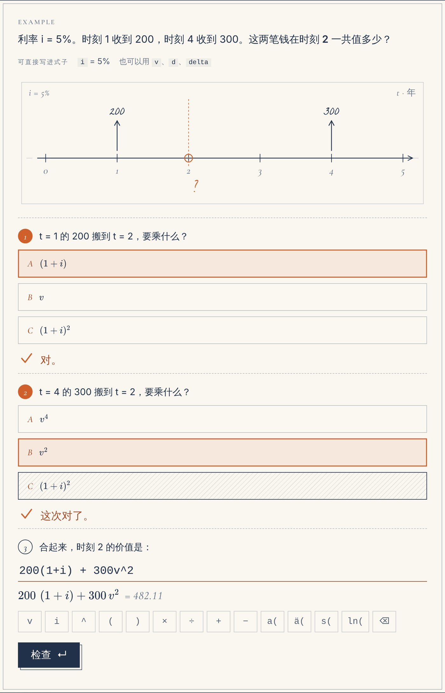
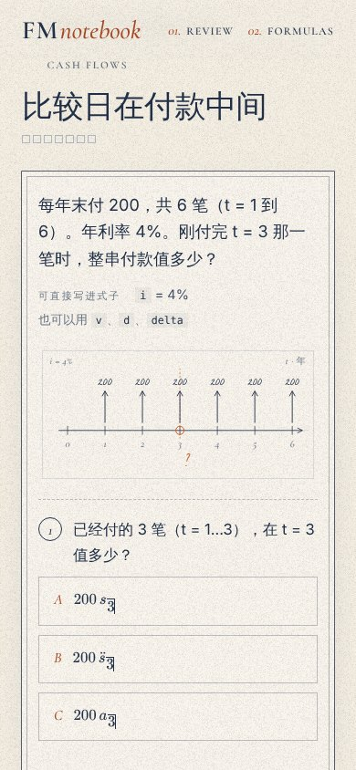
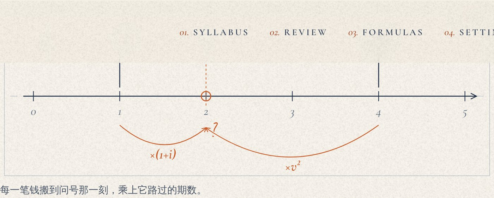
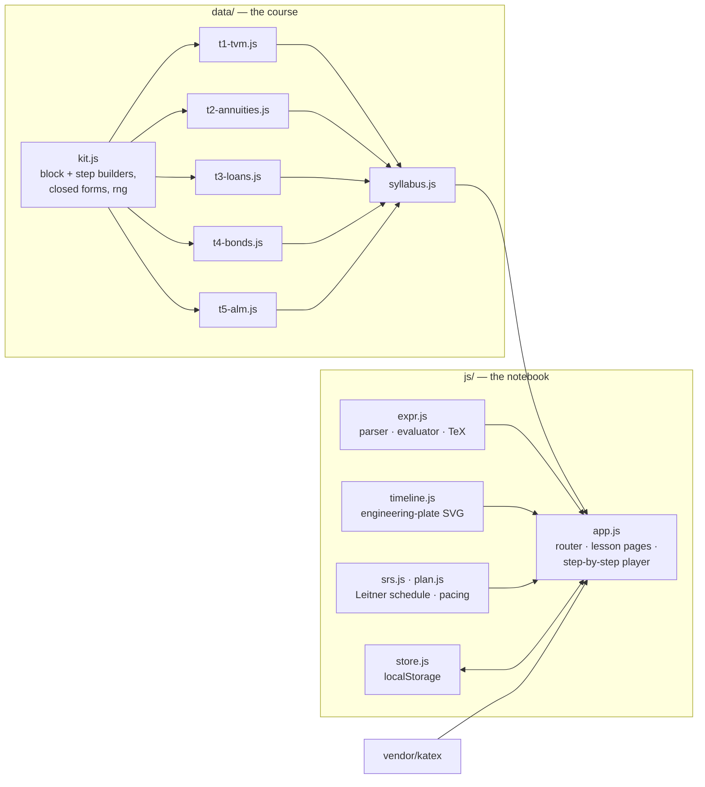

<div align="center">

# FM Notebook

**A no-calculator study notebook for SOA Exam FM — every problem drawn on a timeline and solved one reasoning step at a time.**

[**Open the notebook →**](https://ellensyuu.github.io/FM/) &nbsp;·&nbsp; 30 lessons · 108 drill types · all five syllabus topics

[](https://github.com/EllenSyuu/FM/actions/workflows/site.yml)


</div>

## Why

Most Exam FM material assumes a desk, paper and a BA II Plus. This notebook is for the other
moments — a phone on the metro, ten minutes between meetings — and for someone meeting the
formulas for the first time.

So a drill never asks for a number worked out by hand. It asks for the **reasoning**:

1. **Draw** — which payment sits at which date, in which direction.
2. **Move** — to compare money, carry every payment to one date: forward × $(1+i)^k$, back × $v^k$.
3. **Write** — type the set-up, e.g. `250a(10)v^3`. The page evaluates it, shows it as typeset
   maths, and checks the value.
4. **Return** — the same kind of problem comes back with new numbers on a spaced schedule
   (1, 2, 4, 7, 15, 30, 60 days) until it can be written without a hint.

<table>
<tr>
<td width="62%"></td>
<td width="38%" valign="top"><br><br><sub>Phone width: timelines re-scale so every label stays legible; the keypad supplies <code>v</code>, <code>^</code>, <code>a(</code>, <code>ä(</code> and the rest.</sub></td>
</tr>
</table>

When a problem is solved, its timeline redraws each payment travelling to the date asked about,
labelled with the factor it picks up:



## What is covered

The lessons follow the five topics of the SOA Exam FM syllabus (February 2027 sitting) and its
learning objectives, plus the required reading on duration and convexity approximations.

| Topic | Exam weight | Lessons | Drill types |
| --- | --- | ---: | ---: |
| I. Time value of money — rates, discount, nominal rates, force of interest, real rates | 5–15% | 6 | 20 |
| II. Annuities — immediate/due, perpetuities, deferral, values at any date, mismatched periods, arithmetic, geometric, continuous | 20–30% | 8 | 32 |
| III. Loans — amortization, outstanding balance, interest/principal split, drop and balloon payments, refinancing | 15–25% | 4 | 15 |
| IV. Bonds — price, premium/discount, book value and amortization, callable bonds, coupon reinvestment | 15–25% | 5 | 17 |
| V. Cash flows and ALM — NPV and yield, spot/forward rates, duration, convexity, price approximations, Redington and full immunization, exact matching | 20–30% | 7 | 24 |

Each lesson has an explanation (Chinese prose, exam terms in English), drawn timelines,
formulas with a plain-language reading, a worked example to follow along, and 2–4 drill
generators. A formula notebook collects every formula in syllabus order for revision, and a
study plan paces the remaining lessons against the exam date, keeping the last three weeks
for review.

## How the answers are kept right

A study tool that teaches a wrong number is worse than none, so the content is tested, not
proofread:

- **Every drill is a generator.** `npm test` runs each one with 40 seeds and checks every step:
  exactly one right option, no duplicate options, every timeline in range.
- **Two independent computations per answer.** Each expression step carries a `target`
  computed directly in JavaScript (closed forms or explicit sums) and a `model` set-up written
  in the expression language; the test evaluates the model and requires it to equal the
  target. The solution shown to the learner therefore cannot drift from the answer key.
- **The expression engine** is tested against direct sums for every annuity symbol
  (`a`, `ä`, `s`, `s̈`, `ā`, `(Ia)`, `(Da)`, perpetuities).
- **Every piece of visible maths** — formulas, inline `$…$`, options, model answers — is
  rendered with the vendored KaTeX build in the tests, so a typo cannot reach the page.
- A browser sweep (Playwright) opens all 143 routes at desktop and phone width and checks for
  script errors, KaTeX errors and horizontal overflow.

```text
$ npm test
# pass 68
# fail 0
```

## Architecture

No framework and no build step: plain ES modules served as static files.



| Path | What it does |
| --- | --- |
| [`js/expr.js`](js/expr.js) | A small Pratt parser for set-ups such as `200(1+i) + 300v^2`: implicit multiplication, `%`, superscripts, actuarial functions; evaluates with the problem's variables and produces TeX. |
| [`js/timeline.js`](js/timeline.js) | Draws timelines as inked plates; tap-to-place payments; animated arcs showing each payment moving to the asked date. |
| [`js/app.js`](js/app.js) | Hash router, lesson pages, the problem player (choice / expression / place steps, hints, reveal), review sessions, formula notebook. |
| [`js/srs.js`](js/srs.js), [`js/plan.js`](js/plan.js) | Leitner spaced repetition per drill type; weekly pace to the exam date. |
| [`data/`](data) | The course: one file per syllabus topic. Format in [`docs/content-guide.md`](docs/content-guide.md). |

Progress stays in the browser (`localStorage`), with export/import of a JSON file to move
between devices. Nothing is sent anywhere.

## Run locally

```bash
git clone https://github.com/EllenSyuu/FM.git && cd FM
npm test            # Node 20+, no dependencies to install
npm run serve       # http://localhost:8000
```

## Content and credits

- All explanations, examples and numbers are original to this project. Nothing is copied from
  textbooks, study manuals, commercial question banks or SOA sample questions.
- Not affiliated with or endorsed by the Society of Actuaries. Check the
  [official syllabus](https://www.soa.org/education/exam-req/edu-exam-fm-detail/) for your sitting.
- Visual style shared with [ellensyuu.github.io](https://ellensyuu.github.io): Cormorant
  Garamond, Inter and La Belle Aurore (SIL OFL 1.1). Maths typesetting by
  [KaTeX](https://katex.org) (MIT). See [`NOTICE`](NOTICE).

Code licensed under [Apache-2.0](LICENSE) · © 2026 Ziyi Zhou
